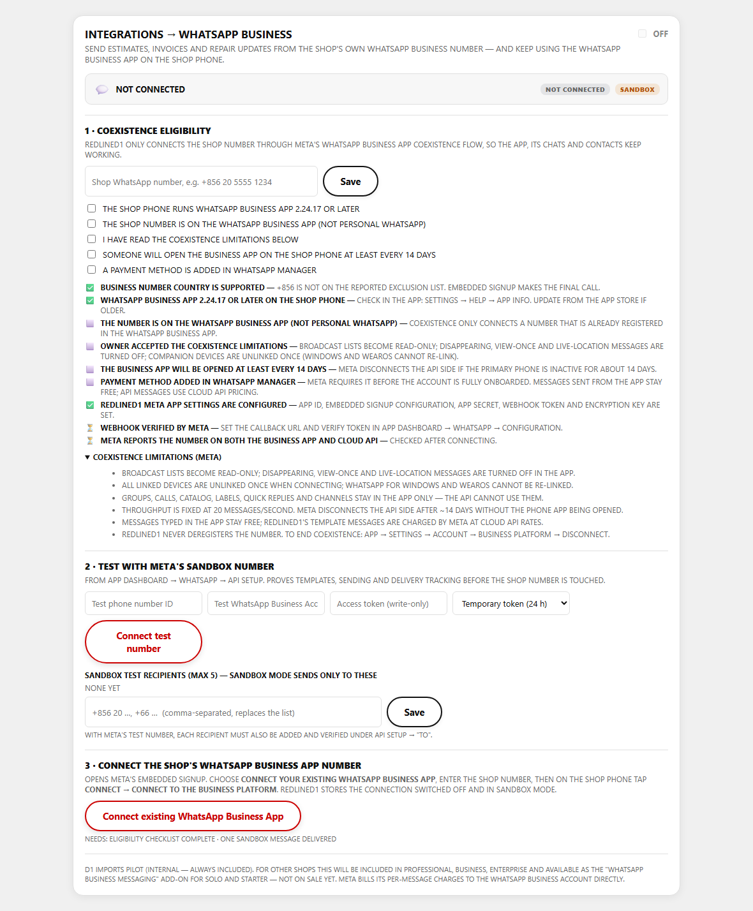
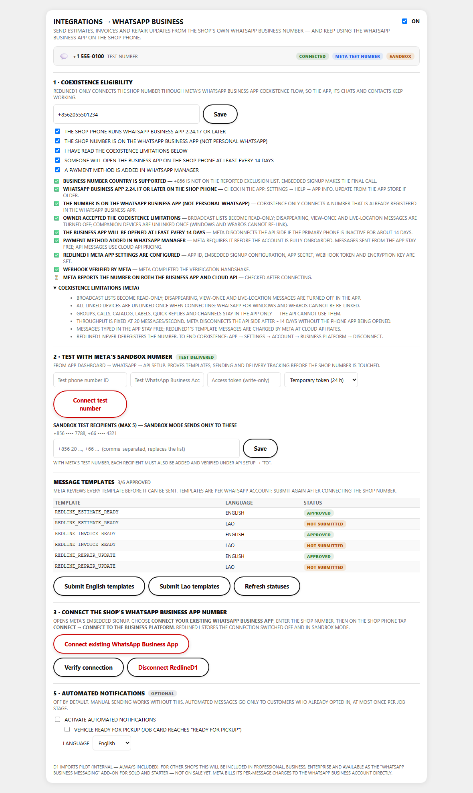
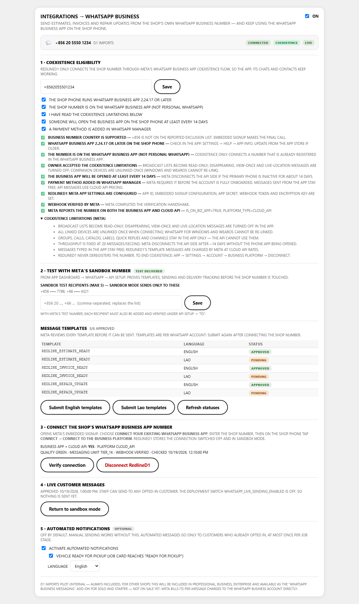
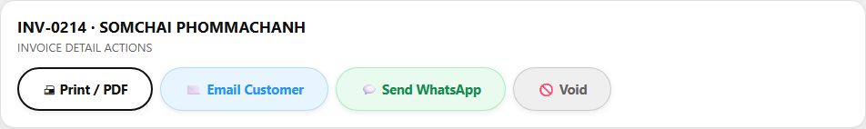
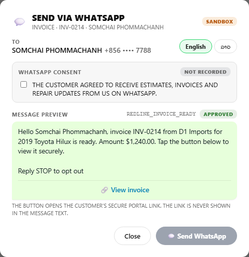
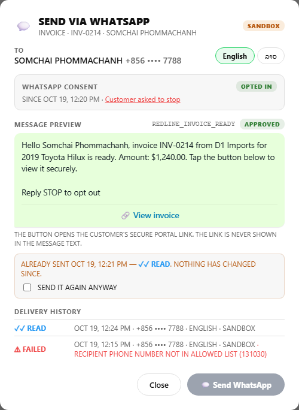
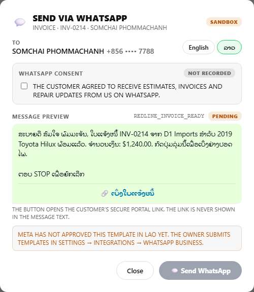

# WhatsApp Business (Meta Cloud API, coexistence)

Send estimates, invoices and repair updates from D1 Imports' own WhatsApp Business number. The WhatsApp Business App keeps working on the shop phone.

**Status: built, OFF.** The feature flag is seeded disabled. The pilot allowlist is the merged D1 Imports shop only. No number is connected, no live message can be sent, and billing is not activated.

| Document | Contents |
|---|---|
| [META_ONBOARDING.md](META_ONBOARDING.md) | Meta requirements, env vars, migration, webhook, sandbox test, coexistence connection, verification, going live |
| [META_LIMITATIONS.md](META_LIMITATIONS.md) | What coexistence changes in the app, Cloud API limits, pricing, and the portal-scope limitation |
| [SECURITY_AND_ROLLBACK.md](SECURITY_AND_ROLLBACK.md) | Access model, secrets, consent, sandbox/live gates, number protection, the 7-level rollback |
| [TEST_RESULTS.md](TEST_RESULTS.md) | What was run and what it proves |

## Where it lives

| Area | Files |
|---|---|
| Core (pure, tested) | `lib/whatsapp/` — `config`, `phone`, `templates`, `eligibility`, `webhook`, `dedupe`, `tokenCrypto`, `resolveDocument`, `sendService`, `status`, `connect`, `cloudApi` (only module that calls Meta), `server` (access guard) |
| API | `app/api/whatsapp/{connection,sandbox,embedded-signup,verify,templates,send,messages,consent,automation}`, `app/api/webhooks/whatsapp` |
| UI | `features/settings/WhatsAppBusinessPanel.tsx` (Settings → Integrations → WhatsApp Business), `components/whatsapp/` (Send WhatsApp button + dialog). The button sits on the invoice and estimate detail views and in the job card status tracker. |
| Entitlement | `config/whatsappEntitlements.ts` (prepared, not live) |
| Database | `supabase/migrations/2026-10-19_whatsapp_business.sql` (+ `_rollback`), `tests/db/run-whatsapp-db-tests.mjs` |

## Screenshots

These are the real components, rendered locally with mocked API responses. No Meta account and no production data were used. The app shell renders labels in uppercase; the message preview keeps the exact casing the customer receives.

| | |
|---|---|
| Settings, before connecting |  |
| Settings, sandbox test number connected |  |
| Settings, shop number in coexistence, live approved, automation on |  |
| Invoice actions with Send WhatsApp |  |
| Send dialog: consent not yet recorded |  |
| Send dialog: opted in, already sent (read), delivery history |  |
| Send dialog: Lao template (pending Meta approval) |  |
